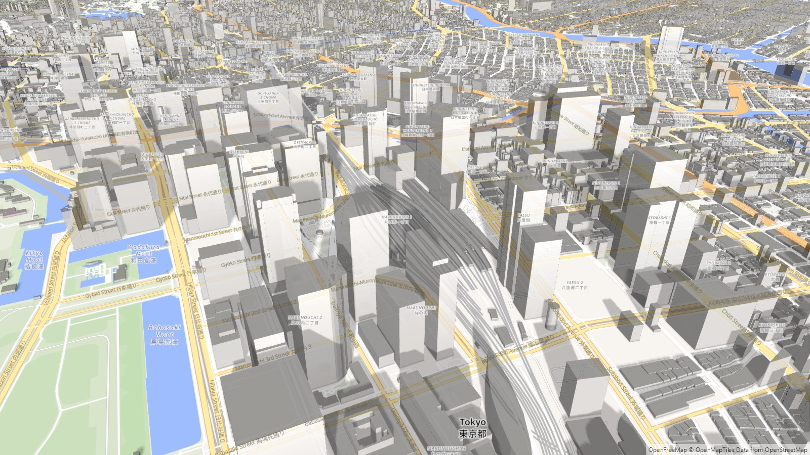
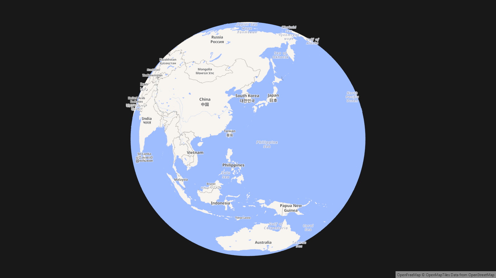
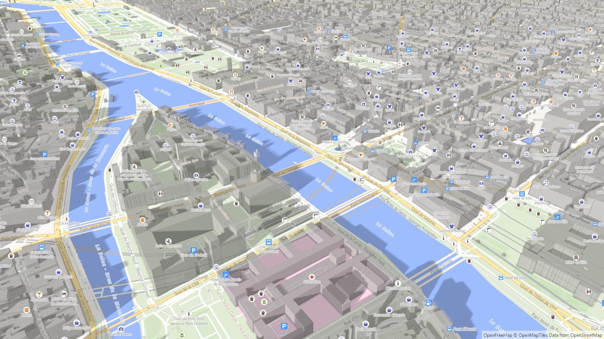
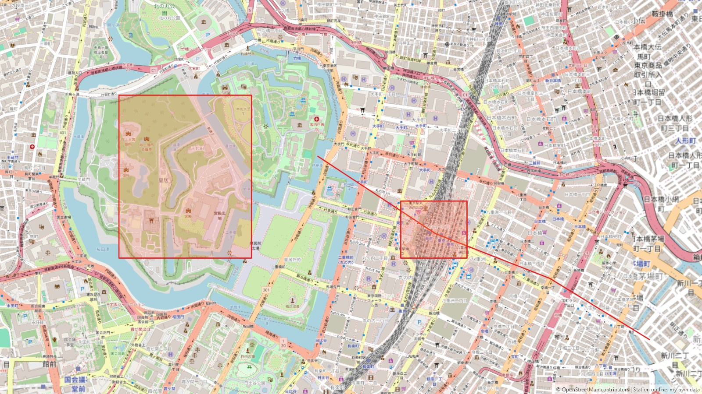

# VL.Globe

A globe of map tiles for vvvv gamma, drawn with Stride, from the whole Earth down to street level.

**Early: a first release, and the nodes may still change.**

For use with vvvv, the visual live-programming environment for .NET: http://vvvv.org

## What it does

**A globe in one node**
* `GlobeWindow` opens a window with a globe that answers the mouse; `Globe` is the same globe as an entity, for a scene of your own
* Precise at street level: buildings and your own objects stay steady from 20 m above the ground up to the whole planet

**Map layers**, stacked in any order with `Group`
* Raster tiles: `OpenStreetMap`, or any XYZ tile service with `XyzTiles`, each with an opacity
* Vector tiles: `VectorTiles` draws a [MapLibre style](https://maplibre.org/maplibre-style-spec/), read from a URL or a file: fills, lines, circles, labels that avoid each other and follow roads, icons, and 3D buildings. Drawn on the GPU after MapLibre GL JS and checked against its render tests
* Your own data: `Geometry` and `FeatureLayer` draw [NetTopologySuite](https://github.com/rednotfound/VL.NetTopologySuite) points, lines and polygons with a `VectorStyle`; `Graticule` draws meridians and parallels
* `TileCache` chooses where tiles are kept on disk, for how long, and how much

**A camera that moves like a map**
* `GlobeCamera`: drag to pan, wheel to zoom, right-drag to turn and tilt; north stays up
* `FlyTo`, `CenterOn`, `ZoomToBounds`, `ZoomToLevel`, `ZoomIn`, `ZoomOut`

**Reading the map**
* `Pick`: the feature under the mouse, with its attributes
* `ScreenToGlobe`, `GlobeToScreen`, `GlobeViewInfo`: between pixels, longitude / latitude and the view
* `ToGlobe`, `FromGlobe`: between longitude / latitude / height and positions on the globe

**Your own 3D things**
* `GlobePositionComponent` stands any Stride entity on the globe at a longitude, latitude and height
* `SunLight`: the sun at a date and time lights the 3D buildings, and they cast shadows

## What it does not do yet

* No terrain: the globe is a smooth sphere at sea level (elevation is the next release)
* No scale bar, zoom buttons or other on-screen widgets
* Vector styles: the layer types `heatmap`, `hillshade` and `raster`, and pattern fills and lines, are not drawn; a style using them still loads, without those layers
* Tile sources are Web Mercator XYZ; no WMS, WMTS or 3D Tiles
* No sky or atmosphere; the ground is not darkened at night
* Tried on vvvv gamma 7.4 only

## Where it is going

* **0.1, this release**: what [VL.Mapsui](https://github.com/rednotfound/VL.Mapsui) does on a flat map, on a globe, plus vector tiles
* **0.2**: terrain, with heights above sea level, on the ground and above the ground
* After that, GIS features come before visual polish: more ways to bring data in, to style it and to ask the map questions. The plan and its reasons are in [docs/ROADMAP.md](https://github.com/rednotfound/VL.Globe/blob/main/docs/ROADMAP.md)

## Getting started
- Requires vvvv gamma 7.4 (.NET 8, Stride 4.2).
- Install as [described here](https://thegraybook.vvvv.org/reference/hde/managing-nugets.html) via commandline:

    `nuget install VL.Globe -pre`

- Usage examples are included in the pack and can be found via the [Help Browser](https://thegraybook.vvvv.org/reference/hde/findinghelp.html). Start with *Explanation Overview of available nodes*, then *HowTo Open a globe window*; every node opens its own example with **F1**.

## Map tiles
- A tile layer fetches from the internet only while its **Enabled** is on, and it is off until you switch it on - in the help patches too. The window is on by itself.
- Raster tiles are cached under `%LOCALAPPDATA%\VL.Mapsui\tiles` (shared with VL.Mapsui), vector tiles under `%LOCALAPPDATA%\VL.Globe\vector-tiles`: for 7 days and up to 4 GB, older tiles are deleted. `TileCache` sets another folder and other limits, and clears it.
- Each tile service sets its own terms. The credit prints in the window by itself; for an `XyzTiles` layer or your own data, fill in its `Attribution` pin.
- To edit a vector tile style, save it as a `.json` file, open it in [Maputnik](https://maplibre.org/maputnik/), read it with `MapLibreStyle (File)`, and press its `Read` after each save.

## Related packages
- [VL.NetTopologySuite](https://github.com/rednotfound/VL.NetTopologySuite): make the geometry drawn on the globe
- [VL.NetTopologySuite.GeoJSON](https://github.com/rednotfound/VL.NetTopologySuite.GeoJSON): read and write GeoJSON
- [VL.Mapsui](https://github.com/rednotfound/VL.Mapsui): the same layers on a flat map, as a VL.Skia layer
- [VL.PROJ](https://github.com/rednotfound/VL.PROJ): move coordinates from one coordinate system to another

## Contributing
- Report issues on [GitHub](https://github.com/rednotfound/VL.Globe/issues)
- What exists and why: [docs/ARCHITECTURE.md](https://github.com/rednotfound/VL.Globe/blob/main/docs/ARCHITECTURE.md); what is planned: [docs/ROADMAP.md](https://github.com/rednotfound/VL.Globe/blob/main/docs/ROADMAP.md)
- When making a pull-request, please make sure to read the general [guidelines on contributing to vvvv libraries](https://thegraybook.vvvv.org/reference/extending/contributing.html)

## Credits
Vector tiles are drawn after [MapLibre GL JS](https://github.com/maplibre/maplibre-gl-js) (BSD-3-Clause) and checked against its render tests. Uses [BruTile](https://github.com/BruTile/BruTile) (Apache-2.0) for tile schemas and [NetTopologySuite](https://github.com/NetTopologySuite/NetTopologySuite) (BSD-3-Clause) for geometry. Map data from OpenStreetMap is © OpenStreetMap contributors, available under the [ODbL](https://www.openstreetmap.org/copyright). The style shipped with the examples derives from [OSM Liberty](https://github.com/maputnik/osm-liberty) through [OpenFreeMap](https://openfreemap.org); the full notices are in [THIRD-PARTY-NOTICES.md](https://github.com/rednotfound/VL.Globe/blob/main/THIRD-PARTY-NOTICES.md).

## License
[MIT](https://github.com/rednotfound/VL.Globe/blob/main/LICENSE)
